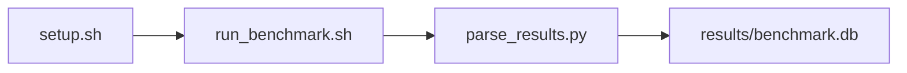

# NUMA Cache Latency Sweep Benchmark

[](LICENSE)
[](https://github.com/garys-gpu-benchmarks/110-sys-bench-amd-numa-cache-performance-ubu2404/actions/workflows/ci.yml)

Target: Ubuntu 24.04 · AMD · see Hardware Requirements. This is a host benchmark, not a laptop `pip install` project.

## Quick Start

```bash
git clone https://github.com/garys-gpu-benchmarks/110-sys-bench-amd-numa-cache-performance-ubu2404.git
cd 110-sys-bench-amd-numa-cache-performance-ubu2404
sudo bash setup.sh --assume-yes
bash run_benchmark.sh --profile smoke --validate
```
Results are written to `results/benchmark.db` and `results/summary.json`.

This workload is executed on the validation host after the repository is copied there. `setup.sh` and `run_benchmark.sh` do not open an outbound SSH session.

Prerequisites: Ubuntu 24.04; AMD; Python 3.14.8 (uv-managed CPython from `uv python install 3.14`; all benchmark venvs). System Python 3.12.3 retained for OS and setup scripts only; root or sudo for `setup.sh`. Framework: Bash, SQLite, Python, PyYAML, C/C++, CMake, GCC, OpenMP, NUMA, numactl. This is a host benchmark, not a laptop `pip install` project.



## Download as a Bundle

This repository is one of the 32 workloads in the AMD Ubuntu 24.04 bundle, [`bundle-amd-ubuntu-2404`](https://github.com/garys-gpu-benchmarks/bundle-amd-ubuntu-2404), which holds them as git submodules pinned to a release. To put every workload for this platform on a GPU host in one step, run this as root (or put `sudo` in front of the `apt-get` and `git clone` commands):

```bash
apt-get update && apt-get install -y git
git clone --recurse-submodules https://github.com/garys-gpu-benchmarks/bundle-amd-ubuntu-2404 /opt/benchmarks \
  && cd /opt/benchmarks \
  && ./run_benchmark_suite.sh --list \
  && cd /opt/benchmarks/110-sys-bench-amd-numa-cache-performance-ubu2404 \
  && bash run_benchmark.sh --profile smoke --validate \
  && cd /opt/benchmarks \
  && echo "Done: 32 workloads in /opt/benchmarks; 110-sys-bench-amd-numa-cache-performance-ubu2404 smoke run passed. Next: ./run_benchmark_suite.sh --help"
```

Every line in `./run_benchmark_suite.sh --list` should show `ready`; it exits with an error if any workload is not fetched. The commands are joined with `&&`, so if the clone, the list or the smoke run fails, the chain stops there, and the closing message appears only when everything succeeded. The chain ends in `/opt/benchmarks`, where the suite runner is. For more extensive testing:

```bash
./run_benchmark_suite.sh -p smoke                 # smoke test of all 32 workloads
./run_benchmark_suite.sh -w 107 -p baseline       # workload 107, baseline profile
./run_benchmark_suite.sh --help                   # all options
```

A workload that is not set up yet sets itself up on its first run (its `run_benchmark.sh` calls `scripts/ensure_setup.sh`). See [Suite Tools](#suite-tools) for more.

To move to the newest published release later: `cd /opt/benchmarks && git pull && git submodule update --init --recursive`.

| Bundle repository | Platform | Workloads |
|---|---|---|
| [`bundle-amd-ubuntu-2404`](https://github.com/garys-gpu-benchmarks/bundle-amd-ubuntu-2404) | AMD · Ubuntu 24.04 | 101–132 |
| [`bundle-nvidia-ubuntu-2404`](https://github.com/garys-gpu-benchmarks/bundle-nvidia-ubuntu-2404) | NVIDIA · Ubuntu 24.04 | 201–232 |
| [`bundle-amd-ubuntu-2604`](https://github.com/garys-gpu-benchmarks/bundle-amd-ubuntu-2604) | AMD · Ubuntu 26.04 | 301–332 |
| [`bundle-nvidia-ubuntu-2604`](https://github.com/garys-gpu-benchmarks/bundle-nvidia-ubuntu-2604) | NVIDIA · Ubuntu 26.04 | 401–432 |

## Suite Tools

Three operator scripts from [`garys-gpu-benchmarks/gpu-bench-suite`](https://github.com/garys-gpu-benchmarks/gpu-bench-suite) work across the whole bundle. `run_benchmark_suite.sh` and `show_metrics.sh` are also at the top of every bundle (and the generator's remote copy installs `show_metrics.sh` at `/opt/benchmarks`); each script prints full usage with `--help`.

- **`run_benchmark_suite.sh`** (on the GPU host) — runs the installed workloads one after another for each profile, writes one log to `/opt/benchmarks/benchmark_suite_log/`, and ends with a pass/fail summary.
  ```bash
  cd /opt/benchmarks
  ./run_benchmark_suite.sh --dry-run                    # list what would run
  ./run_benchmark_suite.sh -w 110 -p smoke,baseline   # just this workload
  ./run_benchmark_suite.sh -p smoke                     # every workload, smoke profile
  ./run_benchmark_suite.sh -r 20                        # soak: everything, 20 times
  ```
- **`get_remote_info.sh`** (on your laptop; Git Bash on Windows) — over one SSH connection, copies the runtime ledger and every workload's `results/raw`, `results/parsed` and suite logs into `RUNTIME_LEDGERS/` and `DIRECTORIES/`.
  ```bash
  git clone https://github.com/garys-gpu-benchmarks/gpu-bench-suite && cd gpu-bench-suite
  ./scripts/get_remote_info.sh --host 203.0.113.10              # root@host, port 22
  ./scripts/get_remote_info.sh --host ubuntu@203.0.113.10 --port 2222 -i ~/.ssh/id_ed25519 -o ~/results
  ```
- **`show_metrics.sh`** (laptop or GPU host) — prints one workload's runs from the runtime ledger in fixed-width metric columns with per-profile means. On the GPU host it is `/opt/benchmarks/show_metrics.sh`.
  ```bash
  cd /opt/benchmarks && ./show_metrics.sh 110             # on the GPU host
  ./scripts/show_metrics.sh 110 --host 203.0.113.10            # over SSH, all profiles
  ./scripts/show_metrics.sh 110 --baseline --file RUNTIME_LEDGERS/<ledger>.csv
  ```

## 1. Overview

Builds bin/numa_sweep and walks yaml source versus target NUMA nodes for each working_set_size. source_numa_node, target_numa_node, num_threads, page_size, stride, access_pattern, cache_level, and num_iterations come from yaml. Optional perf stat -e cache-misses may be attached. The harness raw file keeps local/remote latency columns; overlay also has ratio, bandwidth, and miss-rate fields Sweep dimensions: source_numa_node, target_numa_node, num_threads, thread_affinity, page_size, working_set_size, cache_level, access_pattern.

## 2. What It Validates

- Validates local and remote NUMA latency rows from numa_sweep. Do not pass a single --working-set-size or the sweep collapses
- #1: Largest cache-tier pointer-chase latency, ns (cache_latency_nsec); is present and physically sensible.
- #2: Local DRAM pointer-chase latency, ns (local_numa_node_latency_nsec); is present and physically sensible.
- #3: Pointer-chase payload rate, GB/s (local_dram_pointer_chase_bandwidth_gb_s); is present and physically sensible.
- #4: DRAM-tier cache misses/s (cache_miss_counters_misses_sec) is present and physically sensible.

## 3. Metrics Captured

- **#1: Largest cache-tier pointer-chase latency, ns** — stored as `cache_latency_nsec`.
- **#2: Local DRAM pointer-chase latency, ns** — stored as `local_numa_node_latency_nsec`.
- **#3: Pointer-chase payload rate, GB/s** — stored as `local_dram_pointer_chase_bandwidth_gb_s`.
- **#4: DRAM-tier cache misses/s** — stored as `cache_miss_counters_misses_sec`.

## 4. Hardware Requirements

### Supported environment

- OS: Ubuntu 24.04
- GPU vendor: AMD
- Framework family: Bash, SQLite, Python, PyYAML, C/C++, CMake, GCC, OpenMP, NUMA, numactl
- Python: Python 3.14.8 (uv-managed CPython from `uv python install 3.14`; all benchmark venvs). System Python 3.12.3 retained for OS and setup scripts only

### Reference validation environment

The tables below describe the machine used to generate the reference results. They are not a requirement that every user buy that exact cloud instance.

### System

Ubuntu 24.04 / AMD / Bash, SQLite, Python, PyYAML, C/C++, CMake, GCC, OpenMP, NUMA, numactl

### GPU

Ubuntu 24.04 / AMD / Bash, SQLite, Python, PyYAML, C/C++, CMake, GCC, OpenMP, NUMA, numactl

## 5. Software Requirements

| Component | Version |
|---|---|
| OS | Ubuntu 24.04 |
| Kernel | kernel 6.8.0 |
| Python | Python 3.14.8 (uv-managed CPython from `uv python install 3.14`; all benchmark venvs). System Python 3.12.3 retained for OS and setup scripts only |
| ROCm | N/A - ROCm not used |
| rocBLAS | N/A - rocBLAS not used |

Builds bin/numa_sweep and walks yaml source versus target NUMA nodes for each working_set_size. source_numa_node, target_numa_node, num_threads, page_size, stride, access_pattern, cache_level, and num_iterations come from yaml. Optional perf stat -e cache-misses may be attached.

## 6. Installation

```bash
Build and run bin/numa_sweep via scripts/collect_numa_cache.py, optionally wrapped with perf stat, binding execution to a NUMA node via numactl
```

## 7. Running the Benchmark

```bash
Build and run bin/numa_sweep via scripts/collect_numa_cache.py, optionally wrapped with perf stat, binding execution to a NUMA node via numactl
```

**Validating results separately:**

```bash
export BENCHMARK_PYTHON=/usr/bin/python3.13  # optional
python3 -m venv .venv
source ".venv/bin/activate"
".venv/bin/python" scripts/validate_results.py
```

## 8. Output

### `results/benchmark.db` (SQLite)

overlay.csv from collect_numa_cache.py, then a harness raw CSV of the summary columns. Per-size rows stay in per_size.csv

source_numa_node,target_numa_node,working_set_size,cache_level,access_pattern,stride,num_threads,page_size,local_numa_node_latency_nsec,remote_numa_node_latency_nsec,cross_socket_numa_penalty_ratio,local_dram_pointer_chase_bandwidth_gb_s,cache_miss_counters_misses_sec,cache_latency_nsec
0,0,268435456,DRAM,random,64,1,4KB,80,,,1.2,1000,12

```bash
Build and run bin/numa_sweep via scripts/collect_numa_cache.py, optionally wrapped with perf stat, binding execution to a NUMA node via numactl
```

### `results/summary.json`

Consolidated metrics from the most recent run — suitable for CI artifact upload or dashboard ingestion.

### `results/raw/<timestamp>.txt`

overlay.csv from collect_numa_cache.py, then a harness raw CSV of the summary columns. Per-size rows stay in per_size.csv

source_numa_node,target_numa_node,working_set_size,cache_level,access_pattern,stride,num_threads,page_size,local_numa_node_latency_nsec,remote_numa_node_latency_nsec,cross_socket_numa_penalty_ratio,local_dram_pointer_chase_bandwidth_gb_s,cache_miss_counters_misses_sec,cache_latency_nsec
0,0,268435456,DRAM,random,64,1,4KB,80,,,1.2,1000,12

## 9. Baselines / Thresholds

Expected ranges and gates live in `config/benchmark_config.yaml` under `baselines:` or `thresholds:`. To update them, edit that file — never edit validation code directly.

## 10. Troubleshooting

**`setup.sh` missing collector**
Create cannot finish without `scripts/collect_workload.py`.

**`self_check` overlay rewritten**
Do not overwrite files listed in `results/overlay_lock.json`.

**Remote SSH drop during setup**
Reconnect and resume `bash setup.sh --assume-yes`. Do not wipe `.venv` or `.cache`.

## 11. NVIDIA H100 Coding Differences

Primary target is AMD ROCm. NVIDIA notes in this section are reference only and are not the execution path.

## Repository layout

```text
.
├── setup.sh
├── run_benchmark.sh
├── benchmark_specification.json
├── .github/workflows/      # thin CI callers (see Continuous Integration)
├── config/
├── scripts/
├── src/
├── tests/
├── docs/
├── results/
└── LICENSE
```

## Continuous Integration

| Workflow | Runs on | When | What it does |
|---|---|---|---|
| [CI](.github/workflows/ci.yml) | GitHub-hosted runner | every pull request, and every push to `main` | shellcheck, ruff, `bash -n`, `compileall`, `run_benchmark.sh --help`, specification schema, the results validator on a seeded fixture, required files, and actionlint. No GPU and no benchmark run. |
| [GPU Smoke Benchmark](.github/workflows/gpu-smoke.yml) | self-hosted runner labeled `gpu`, `amd`, `ubu2404` | only when started by hand: **Actions → GPU Smoke Benchmark → Run workflow** (choose `smoke`, `baseline` or `extended`) | Verifies the pre-provisioned GPU stack, records `results/environment.json` (driver, runtime, kernel, GPU), runs the profile with `--validate`, shows headline metrics on the run page, and uploads the results. |

Both files are short callers. The steps themselves live once, for every workload in the suite, in [`garys-gpu-benchmarks/shared-workflows`](https://github.com/garys-gpu-benchmarks/shared-workflows), pinned at `@v1`. The GPU workflow is never triggered by pull requests, so code from a fork cannot run on the GPU host.

The GPU Smoke Benchmark workflow runs one workload. To install and run the whole AMD Ubuntu 24.04 bundle by hand on the same machines, see [Download as a Bundle](#download-as-a-bundle) and [Suite Tools](#suite-tools).
